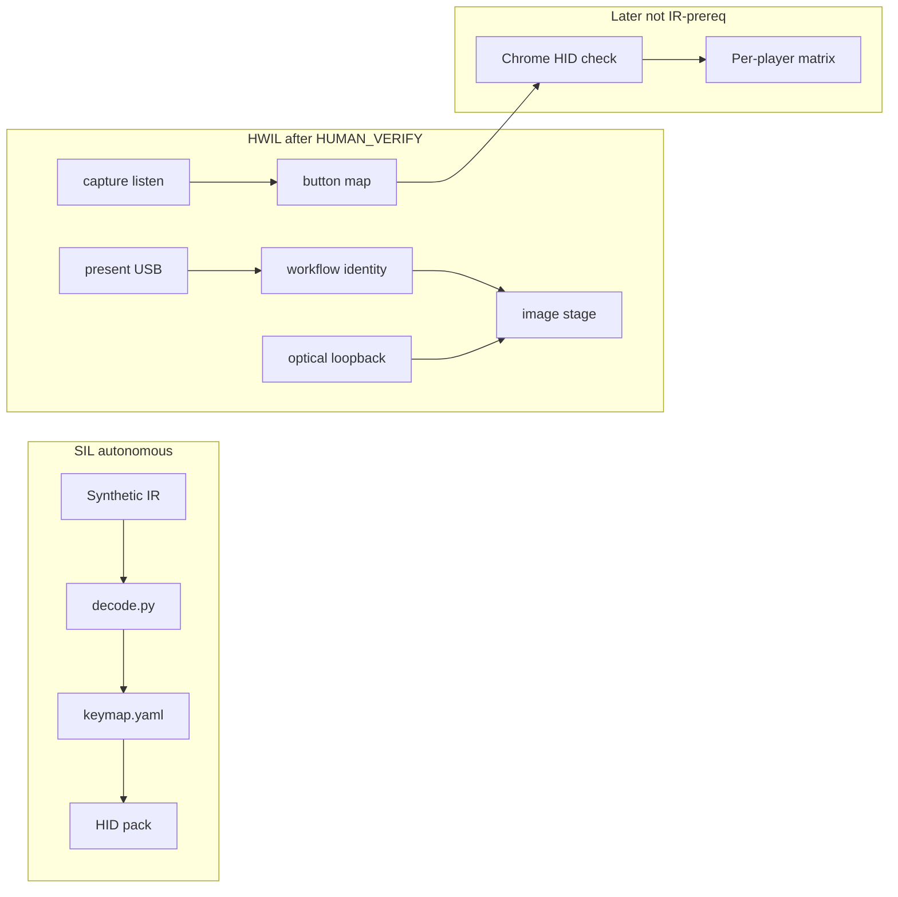

# Archived bring-up record

This file records how the gateway was brought up. It is not the working method.
Current confirmation flags are `OPERATOR_*`. The method is [`../methodology/operator-loop.md`](../methodology/operator-loop.md).
Names below (`HUMAN_*`, `lesson/`, `harness/`, `human/`) describe the tree during that bring-up.

# Post-mortem and Agentic Engineering plan — ir-remote-bose

**Date:** 2026-10-27  
**Scope:** Evidence-based reconstruction, post-mortem, staged bring-up redesign, agentic process improvements, and GitHub readiness.  
**Constraints honored:** No firmware behavior changes in this review write; no publish/push; sibling repos inspected read-only only where present.

Evidence labels:

| Label | Meaning |
| --- | --- |
| **Verified** | Supported by files, manuals (`pdftotext`), tests, or archived `reports/` stamps in this workspace |
| **Reported** | Operator notes in-repo or project brief; not independently re-measured here |
| **Hypothesis** | Plausible inference; needs new evidence to confirm or reject |

---

## 1. Executive summary

The project goal is clear and achievable: use a Bose CineMate universal remote in **AUX** mode as IR input to a Raspberry Pi Pico, then inject ordinary USB HID keys into Chrome on Linux. Role-gated methodology (from rad-lab), host SIL decode (including Sony SIRC-20), assent gates, and listen-only capture produced **Verified** AUX+`20636` button→frame maps. Optical loopback eventually passed as a separate stamp.

Bring-up is **not** product-complete. The recorded `image` stage pass is a **SIL optical proxy**, on-device [`hardware/firmware/pico/code.py`](../../hardware/firmware/pico/code.py) is still a pin/keymap placeholder, CIRCUITPY has shown missing `adafruit_hid`, and no evidence proves measured SIRC → Pico HID → Chrome. Blink semantics for remote programming remain **contradictory** across the owner’s guide, early operator readings, and a later “blink correction.” Per-player control validation is profile data plus SIL tests only.

Highest-leverage next moves: a living `STATUS.md`, a blink observation worksheet, IR stages independent of HID/Chrome, on-device firmware using measured keys, then a Kanopy player matrix—then GitHub P0 (git, LICENSE, SIL CI) when publishing.

**Sibling lessons:** rad-lab, crt-drive, fpga-kit, astro-study, and astro-psets were inspectable under `/home/plastic/src/`. **`cede` has no local tree**; crt-drive only references it remotely as a pico-dev precedent. No cede practices are claimed from memory.

---

## 2. Project reconstruction

### 2.1 Intended system (**Verified** from [`SPEC.md`](../SPEC.md) — formerly root `PROMPT.md` — plus [`README.md`](../../README.md), [`docs/methodology/domain.md`](../methodology/domain.md))

- **Input:** CineMate universal remote; prefer AUX programmed with a library device code (VCR/DVR lists; no separate “AUX” code book).
- **Gateway:** Pico IR RX → decode → keymap → USB HID keyboard/consumer control for Chrome.
- **Phase 1 policy:** Receive-only toward the CineMate Interface module; IR LED = optical loopback / future TX.
- **Phase 2 (deferred):** Web + TX toward Interface; new assent.

### 2.2 Current implementation shape (**Verified**)

| Role | Tree | Notes |
| --- | --- | --- |
| Human assent | `human/` | `HUMAN_VERIFY`, `HUMAN_FLASH`, `HUMAN_IR_PATH`; agents must not invent |
| HWIL | `hardware/` | Stages, capture, loopback, firmware deploy |
| SIL | `software/` | Decode, HID pack, profiles, fixtures |
| Environment | `environment/`, `docker/` | pico-dev image, UF2 flash helpers (crt-drive pattern) |
| Harness | `harness/` | Paths, ready gates, import lint |
| Lesson | `lesson/` | Unlocked by image-stage evidence |
| Protoboard | `docs/kicad/ir-gateway/` | Wire-wrap schematic/PCB |

### 2.3 Confirmed status vs remaining work

| Item | Evidence | Claim |
| --- | --- | --- |
| Host SIL | `make check` → **39 passed** (2026-10-27) | **Verified** green; does not prove HWIL |
| `present` | [`reports/pico/stage.json`](../../reports/pico/stage.json) pass @ 2026-10-24T16:02:49Z; Adafruit `239a:80f4` | **Verified** then; re-run when USB identity changes |
| `workflow` | Same stamp; CIRCUITPY mount + firmware tree; **pins null in record** | **Verified** then; YAML now `ir_rx: 14`, `ir_tx: 15` — record stale |
| `image` / `make hwil` | `fixture.mode: sil-optical-proxy` in stage metrics; [`software/fixture.py`](../../software/fixture.py) | **Not** live IR→HID; treat as SIL/assent gate only |
| Optical loopback | [`reports/pico/20261026T210622Z/loopback.json`](../../reports/pico/20261026T210622Z/loopback.json) `ok: true` (earlier stamps failed) | **Verified** eventual pass; **separate** from `image` |
| On-device firmware | `code.py`: `IR_RX_PIN = None`, synthetic nec-like `KEYMAP`, decode returns `None` | **Verified** placeholder — product path not on device |
| Device HID libs | Loopback reboot log: `ImportError: no module named 'adafruit_hid'` | **Verified** CIRCUITPY may lack HID even when loopback script OK |
| AUX+20636 IR map | [`reports/pico/20261027T043341Z/captures/validated.json`](../../reports/pico/20261027T043341Z/captures/validated.json) — 21 buttons `validated: true`, all `hid: null`; inventory [`docs/remote/button-inventory.md`](../remote/button-inventory.md) | **Verified** IR confirm-map; **not** HID |
| Bookkeeping | Same session: `session.json` `on_off_confirmed: false` vs `validated.json` / [`software/profiles/remote.yaml`](../../software/profiles/remote.yaml) confirmed | **Verified** drift |
| Host keymap | [`software/keymap.yaml`](../../software/keymap.yaml) `personality: sony-dvr-20636`, `profile: kanopy` | **Verified** file; Chrome UX not evidenced |
| Doc drift | [`docs/chrome-troubleshooting.md`](chrome-troubleshooting.md) said AUX+**10178**; bring-up / keymap say AUX+**20636** | **Verified** contradiction (fix tracked below) |
| Per-player | Profiles under `software/profiles/`; SIL [`test_profiles.py`](../../software/tests/test_profiles.py) | **Remaining** — no player matrix evidence |
| Git history | No project `.git` (nested KiCad `.history/.git` only) | Cannot cite commits |

### 2.4 Unresolved questions (evidence that would close them)

1. Controlled blink log (program accept, program reject, code-check digits 0–9) with video or structured counts — resolves LED contradictions.
2. Deployed `code.py` with pinned GPIOs + measured SIRC keymap + `adafruit_hid` present — closes on-device gap.
3. Stamp showing HID report / Chrome key-event viewer for one mapped button — closes HID smoke.
4. Filled player matrix rows for Kanopy (then others) — closes per-player validation.
5. Fresh `present`/`workflow` after pin freeze — closes stage/YAML drift.
6. Flash/deploy success artifact (or STATUS note with command + time) — closes “was firmware copied?” ambiguity.

---

## 3. Evidence-based post-mortem

### 3.1 What went well

| Finding | Evidence | Impact | Confidence |
| --- | --- | --- | --- |
| Goal clear enough to pick hardware/libs | Early brief (now [`SPEC.md`](../SPEC.md)), CHQ1838 + Pico docs, CircuitPython HID intent | Fast early architecture | **Verified** / **Reported** |
| Evidence-gated roles + assent | Root [`AGENTS.md`](../../AGENTS.md), `human/assent.py`, methodology mapping | Agents cannot forge physical compliance | **Verified** |
| SIL decode including SIRC-20 | `software/decode.py`, 39 pytest pass | Offline progress without USB | **Verified** |
| Listen-only capture + confirm-map | `20261027T043341Z` unique catalog + `validated.json` | Real AUX button library without inventing IR | **Verified** |
| Profiles as data, not invented IR | `software/profiles/*.yaml` + tests rejecting consumer volume abuse | Safe player encoding tables | **Verified** |
| crt-drive flash discipline reused | [`environment/README.md`](../../environment/README.md) → pico-dev Make/`flash.sh` | Fewer ad-hoc `picotool` mistakes | **Verified** |

### 3.2 What caused friction

| Finding | Evidence | Impact | Likely cause | Confidence | Improvement |
| --- | --- | --- | --- | --- | --- |
| Stages not independent; HID treated as bring-up core | [`hardware/docs/bringup.md`](../../hardware/docs/bringup.md) steps 10–11; `image` → HID fixture | IR validation blocked/confused by Chrome path | End-goal listed HID without IR-only exit criteria | **Verified** + **Reported** | Split stages; IR map pass without HID |
| **Capture-only gap:** unique listen ran while on-device **map** firmware still injected USB HID | 2026-10-28 AUX sanity: terminal received mapped escapes (`Shift+Tab` / arrows) during `make capture`; hits starved / operator saw “passthrough” instead of `frame_key` lines. VCR `21972` listens also `codes=0` amid the confusion (`reports/pico/20261028T025624Z`) | Device-code bring-up (library code → IR frames) mixed with player HID; hard to tell silent code vs RX vs keymap | Host Raw REPL listen did not guarantee HID-off; `MODE=map` remained the live path | **Verified** (2026-10-28) | **Capture-only mode:** `/CAPTURE_ONLY` + `boot.py` `usb_hid.disable()`, firmware decode-only prints, host arms/disarms around unique listen. Finish personality IR **before** map/player integration |
| Blink prose hard to use | Manual ~pp. 14–15, 21 vs [`manual-facts.md`](manual-facts.md) Measured + Blink correction | Wasted programming attempts; contradictory “accept” | Ambiguous LEDs + no structured observation log | **Verified** / **Reported** | Blink worksheet + camera |
| SIL-proxy `image` looks like HWIL done | `stage.json` `sil-optical-proxy`; pins null while later captures use GP14 | False sense of completion | Stage design conflates fixture with physical IR | **Verified** | Rename/split stage; never call proxy “optical pass” |
| Placeholder firmware vs progress narrative | `code.py` pins/keymap still synthetic | Product path not live | Firmware deferred while host capture advanced | **Verified** | Explicit STATUS: “on-device = placeholder” |
| High token / context use | **Reported** in brief; no in-repo token meters | Slow iteration | Broad searches, repeated PDF/manual reads, mixed stages | **Reported** / **Hypothesis** | `STATUS.md`, ADRs, role-scoped turns |
| Doc/personality drift | chrome-troubleshooting 10178 vs keymap 20636 | Agents/operators program wrong source | Docs not updated after restage | **Verified** | Single personality owner + STATUS pointer |
| **Hands-on USB unplug / dead IR after firmware copy** | 2026-10-28: eject+reset ok + digest ok, then serial showed **“Code stopped by auto-reload”** while host touched CIRCUITPY (`.Trash`/`.fseventsd`/remount); LED stopped blinking; also Ctrl-C-after-reset HID wedge; `OPERATOR_FLASH` on every app copy added prompt friction | Dead gateway mid-session; slow iterate | CP **autoreload** on MSC remount/junk; Ctrl-C after reset; FLASH flag over-gating app deploys | **Verified** | `boot.py` **`autoreload=False`**; deploy cleans junk; digest gate; **`make firmware` = VERIFY only**; **`make firmware-watch`** auto-redeploy |
| **D-pad hold kills LED until unplug** | 2026-10-28: after several d-pad up presses LED stopped; needed unplug | Session dead mid-pointer | SIRC repeat → every-frame `Mouse.move` + serial `print` on composite USB wedges CP HID stack | **Verified** | Cap mouse reports (~20/s); **map mode: no CDC echo on presses** (ready banner only); try/except keep IR loop alive |
| **AUX page/channel “dies” while held — blamed on Pico** | 2026-10-28 capture: AUX `1a:10`/`1a:11` a few `[dup]`s then quiet LED; VCR page/channel keep TX while held. Operator: Amazon UI benefits from Up/Down on that rocker | False firmware/PulseIn debug; weak hold-scroll on Prime under AUX+`20636` | **Library device profile** (Sony DVR `20636`) only emits a short IR repeat burst for page/channel; VCR `20033` continuous. Not HID/CDC | **Verified** (operator + unique listen) | Document in [`manual-facts.md`](../manual-facts.md); SEEK_KEYS only paces frames still sent; **open:** try other AUX/DVR (or VCR-on-AUX) codes for continuous page/channel repeat — see §5.1a |

### 3.3 Root causes vs symptoms

| Root cause | Symptoms |
| --- | --- |
| Missing independent stage contracts (IR RX → map → on-device firmware → HID → player) | Bring-up mixes Chrome with IR; `image` SIL pass misread |
| **No capture-only contract separating device-code IR from HID/player** | Library-code programming and unique listen fight live keymap inject; false “dead remote” reads |
| **Deploy treated MSC copy + serial poke as sufficient** | Stale/wedged DUT until physical USB cycle; false “reload ok” without running digest |
| **Assuming IR hold-repeat is uniform across Bose library codes** | “Capture/HID stuck after 4–5 page/channel presses” when AUX personality stopped TX; VCR still fine |
| No living STATUS / decision / handoff log | Re-deriving blink rules and personality from chat |
| Evidence files not reconciled after confirm-map | `session.json` vs `validated.json` disagreement |
| Proxy stages without fidelity label in operator mental model | “Bring-up complete” while `code.py` unpinned |

### 3.4 Goal / architecture / milestones / tests / docs clarity

| Dimension | Assessment |
| --- | --- |
| Product goal | **Clear** (**Verified**) |
| Architecture (roles, phase 1/2) | **Clear** in AGENTS + methodology |
| Milestones / pass criteria | **Weak** — stages exist but IR-only and HID-only exits under-specified (**Verified**) |
| Test criteria | SIL strong; HWIL proofs are stamps + operator judgment, not pytest (**Verified**) |
| Documentation | Strong manuals distillation; some drift and unresolved blink notes (**Verified**) |

---

## 4. LED / blink analysis (do not silently reconcile)

### 4.1 Owner’s guide (**Verified** via `pdftotext` on [`docs/cinemate_cinemate_digital_home_theater_speaker_system.pdf`](cinemate_cinemate_digital_home_theater_speaker_system.pdf))

- **Program accept (~p. 15):** selected source button “blinks twice and turns off” after the five-digit code.
- **Program reject (~p. 15 note):** “five source buttons will flash rapidly three times” for invalid key / unavailable code.
- **Code-check digits (~p. 21):** press 1…5; count blinks of the five source buttons; **“zero is indicated by a long blink.”** No “start flash” wording.

### 4.2 Repo notes (**Reported** / contradictory)

- Measured: three-flash after entering `20636` / `21972`, yet code-check still read `20636` ([`manual-facts.md`](manual-facts.md)).
- Blink correction: short flash then two flashes = accept; earlier three-flash=reject “wrong for this unit.”
- [`software/profiles/remote.yaml`](../../software/profiles/remote.yaml) `blink_semantics` and `prior_attempts` for `21972`/`20034` “misclassified as reject.”
- Code-check archive note: `2, 0, 6, 3, 6` with `0 = long blink` ([`aux_dvr_20636_sirc20.md`](../../reports/pico/20261027T043341Z/captures/aux_dvr_20636_sirc20.md)).

### 4.3 Brief-reported digit/success observations (**Reported**)

| Claim | Relation to manual | Confidence |
| --- | --- | --- |
| Start flash precedes sequence | Not in manual | Uncertain |
| Start+2 = success | Loose align with “blinks twice” if start is extra | Hypothesis |
| Start+3 = error | Loose align with three-flash reject | Hypothesis; conflicts with blink correction |
| Zero = start flash only | Conflicts with manual “long blink” | Contradictory |
| One = start+1 | Plausible if start excluded from digit count | Uncertain |
| Two = start + “1-flashes” | Internal inconsistency | Unresolved |
| Three = start+3 | Digit vs reject ambiguity | Uncertain |

**Do not** collapse these into one story. Closing evidence: fill [`docs/remote/blink-observation-worksheet.md`](../remote/blink-observation-worksheet.md) with separate rows for program-accept, program-reject, and each code-check digit.

**Separate (Verified):** selected **source LED blinks when a press transmits IR** — useful TX activity signal, not programming feedback.

---

## 5. Proposed staged bring-up and validation

Independent stages. **HID is not required** to pass IR reception or button mapping.

### 5.0 Device-code bring-up vs player integration (addendum 2026-10-28)

Treat these as **two lanes**. Do not debug them in the same listen.

| Lane | Question | Mode | Pass when |
| --- | --- | --- | --- |
| **Device code** (personality) | Does this Bose source + five-digit library code emit usable IR? | **Capture-only** — `/CAPTURE_ONLY`, USB HID disabled, serial/`make capture` prints `frame_key` only | Source LED TX + unique/confirm stamps; `unique_codes.json` non-empty for that personality |
| **Player integration** | Does a measured `frame_key` drive the right Chrome/player UI? | **Map** — HID on, union keymap, profile matrix | HID smoke + matrix rows |

Multi-source growth (face order TV / CBL-SAT / DVD / VCR / AUX) stays in the device-code lane until each personality has disjoint frames ([ADR 004](../decisions/004-multi-source-personalities.md)). Only then append union keymap rows and regress prior players.

**Fix shipped for the capture-only gap:** [`hardware/firmware/pico/boot.py`](../../hardware/firmware/pico/boot.py) disables HID when `/CAPTURE_ONLY` exists; [`code.py`](../../hardware/firmware/pico/code.py) decode-only path; [`hardware/capture.py`](../../hardware/capture.py) arms/disarms the flag around unique listen. Reflash before relying on it.

| # | Stage | Inputs | Outputs / evidence | Pass/fail |
| --- | --- | --- | --- | --- |
| 1 | Bench wire | Parts + [`boards/pico.yaml`](../../hardware/boards/pico.yaml) pins | Pin fields filled; optional photo | Pins non-null and match wiring |
| 2 | `present` | `OPERATOR_VERIFY=1` (was `HUMAN_*` in original write) | `stage.json` present | USB identity matches board YAML / Adafruit CP |
| 3 | Firmware load | `OPERATOR_FLASH=1` + present | UF2 + `code.py`/`boot.py` on CIRCUITPY; STATUS note | Mount shows expected files; CAPTURE_ONLY support present |
| 4 | IR RX smoke | Remote press | Capture session / decode lines | At least one frame; **capture-only (no HID)** |
| 5 | Optical loopback | `OPERATOR_IR_PATH=1` | `loopback.json` | `ok: true` under TX ceilings |
| 6 | Remote personality | Setup + code | Code + blink worksheet + code-check | Digits match intended library code; source LED TX |
| 7 | Unique + confirm-map | Capture-only listen / confirm | `unique_codes.json`, `validated.json` | Agreeing samples per button; **no HID inject during listen** |
| 8 | Keymap build | Map + profile | `software/keymap.yaml` union | `make check` + profile consistency; AUX rows regress-safe |
| 9 | HID smoke | On-device **map** mode (CAPTURE_ONLY cleared) | Key-event viewer stamp / STATUS | One mapped key produces expected HID |
| 10 | Per-player matrix | Profiles | [`docs/remote/player-validation-matrix.md`](../remote/player-validation-matrix.md) | Rows pass/fail with stamps |
| 11 | Chrome streaming | Focused player tab | Matrix + troubleshooting notes | Last; not a gate for IR |

**Later refactor (optional):** split Make `image` into loopback / IR-path vs HID fixture so SIL proxy cannot mark physical IR complete.

### 5.1a Multi-source + page/channel hold-repeat (addendum 2026-10-28 evening)

Face order locked: **TV / CBL-SAT / DVD / VCR / AUX**. Union keymap keeps AUX `1a:*:9a` rows; VCR `20033` appends SIRC-12 (+ SIRC-15 page, `b4:5b` replay).

| Observation | AUX `20636` (amazon) | VCR `20033` (youtubetv) | Label |
| --- | --- | --- | --- |
| Page▲ vs Channel▲ IR | **Shared** `sony-sirc20:1a:10:9a` (page press = `[dup]` of channel) | **Distinct:** channel `2:10`/`2:11`; page `sony-sirc15:b4:60`/`b4:62` | **Verified** |
| Page/channel HID (chosen) | Shared → **Up / Down** + SEEK_KEYS (Tab abandoned; useful on Prime chrome UI) | Channel → Up/Down; page → Page Up/Down + SEEK_KEYS | **Verified** map + **Reported** Amazon usefulness |
| Hold while finger down | Source LED + frames stop after a **few** IR repeats | Continuous IR repeat while held | **Verified** (operator; unique listen) |
| Soft-reload / map quiet | Digest-gated CIRCUITPY deploy; map mode silent after ready banner; mouse report cap | same firmware | **Verified** |

**Open (Hypothesis → next measure):** Find another five-digit code programmable on **AUX** (DVR/VCR lists in the Device Codes book) that (1) still maps cleanly for Prime and (2) **keeps repeating** page/channel while held, like VCR `20033`. Procedure: program candidate → code-check → `OPERATOR_VERIFY=1 make capture PERSONALITY=sony-dvr-<code>` (or temporary slot) → hold page/channel and count TX blinks / `[dup]` cadence → only then retarget amazon remote personality. Do **not** assume software can invent repeats the remote never sends.

Capture listen also caps burst edges (~84) so *true* continuous TX (VCR) does not fill PulseIn `maxlen=256` and spawn false `unclassified` NEWs — keep that; it does not fix AUX short-burst personality.

### 5.1 Per-player matrix fields

See template: player, button, remote mode, captured signal/protocol (`frame_key`), mapped HID, expected UI, actual result, status, evidence path.

Profiles: `amazon`, `kanopy`, `paramount`, `youtubetv`. Start with **Kanopy** (active keymap profile).

---

## 6. Agentic Engineering process improvements

### 6.1 Lightweight agent workflow

1. Read root [`AGENTS.md`](../../AGENTS.md) + stand in **one** role tree.
2. Read [`STATUS.md`](../../STATUS.md) (Decided / Working hypothesis / Open / Handoff).
3. 10-line plan; refuse to mix device-code / capture-only debugging with HID or player implementation.
4. Targeted path reads (prefer [`manual-facts.md`](manual-facts.md) over re-PDF).
5. Small diff; `make check` for SIL; HWIL only after operator assent.
6. Handoff: next command + evidence path under `reports/`.

### 6.2 Token / context efficiency

| Practice | Source |
| --- | --- |
| Concise `STATUS.md` as session entry | crt-drive handoff vocabulary; this plan |
| ADR one-pagers (`docs/decisions/`) for personality + blink protocol | proportionate decision records |
| Thin skills that **link** owners (don’t copy rules) | astro-study |
| Failures print **next human command** | rad-lab / existing harness |
| Progress one-liner for long Docker/UF2 | fpga-kit `progress.md` idea |

### 6.3 Observability (tools that exist)

- Record in STATUS: last `make check` result, last HWIL stamp path, wall-clock if operator notes it.
- Cursor usage UI for tokens if available — **do not invent** agent telemetry APIs.
- Keep machine JSON under `reports/`; add short human `REPORT.md` beside judgment steps when assent is required (rad-lab checklist gap).

### 6.4 Anti-patterns

- Broad recursive searches when the path is known.
- Re-reading the PDF when `manual-facts.md` already cites the page.
- Treating `image` SIL-proxy or placeholder `code.py` as product pass.
- Implementing HID while unresolved IR/personality questions remain.
- Setting `HUMAN_*` from an agent role.

---

## 7. GitHub-readiness checklist

| Priority | Item | Owner role | Status / notes |
| --- | --- | --- | --- |
| P0 | Initialize git | human + environment | **Done locally** (`git init -b main`); no remote/push; first commit deferred to human |
| P0 | LICENSE | human | **Done** — MIT |
| P0 | Keep `reports/*` out of public history | harness / human | Already in [`.gitignore`](../../.gitignore) |
| P0 | Secret scan | environment | **Done** 2026-10-27 — no `local.env` / secrets files found; see [`github-readiness.md`](github-readiness.md) |
| P1 | CI: `make check` (SIL only) | environment | **Done** — [`.github/workflows/check.yml`](../../.github/workflows/check.yml) |
| P1 | README clone → venv → check | docs | Present; STATUS / post-mortem linked |
| P1 | UF2/cache policy | environment | `*.uf2` ignored; notes in github-readiness |
| P2 | Exclude KiCad `.history/` (nested `.git`) | kicad | **Done** — `.gitignore` entry |
| P2 | Manual PDF copyright / private vs public | human | Still open before public repo |
| — | Do not push/create remote as part of post-mortem write | — | Honored |

---

## 8. Prioritized action plan

| Order | Task | Acceptance criteria | Depends on |
| --- | --- | --- | --- |
| 1 | This post-mortem report | File exists; labels; LED contradictions preserved | — |
| 2 | `STATUS.md` + blink worksheet | Agents can enter via STATUS; worksheet ready for one controlled session | 1 |
| 3 | Decouple bring-up docs; fix chrome personality | IR map complete without Chrome; AUX+20636 consistent | 1 |
| 4 | On-device firmware path | In-tree: GP14/15 + SIRC + `keymap_gen`; operator: `adafruit_hid` + flash + HID smoke | 2–3, operator flash |
| 5 | Player matrix (Kanopy first) | Rows with evidence; Chrome only after HID smoke | 4 for live HID; matrix template anytime |
| 6 | GitHub P0 | git, LICENSE, SIL CI, ignores | Human publish intent |
| 7 | Refresh `present`/`workflow` | `stage.json` pins match YAML | Pin freeze |

### First next steps

1. Keep `STATUS.md` current after every session.
2. Finish VCR→YouTube TV matrix rows from operator report; Prime/amazon smoke with AUX Up/Down rocker (short burst expected).
3. **Library-code hunt:** candidate AUX codes with continuous page/channel IR repeat (§5.1a) — worksheet + capture, no firmware guesswork.
4. When publishing: LICENSE + git + SIL CI; no force-push; leave `reports/` local.

---

## 9. Sibling-project lessons (Verified availability)

| Repo | Path | Transfer |
| --- | --- | --- |
| rad-lab | `/home/plastic/src/rad-lab` | Roles, dual-loop, checklist, next-command refusals, writeups beside assent |
| crt-drive | `/home/plastic/src/crt-drive` | pico-dev HIL skill; Decided/Open/Handoff; skip ≠ pass |
| fpga-kit | `/home/plastic/src/fpga-kit` | Stage ladder + progress/ETA artifacts; hashed archive status |
| astro-study / astro-psets | `/home/plastic/src/astro-*` | Status tables, LOCKED freeze, one-owner docs + skill pointers |
| cede | — | **Not present locally**; remote mention only in crt-drive toolchains doc |

---

## 10. References (in-repo)

- [`AGENTS.md`](../../AGENTS.md), [`docs/methodology/`](../methodology/)
- [`docs/manual-facts.md`](manual-facts.md), owner’s guide PDF ~pp. 14–15, 21
- [`hardware/docs/bringup.md`](../../hardware/docs/bringup.md), [`hardware/stages.py`](../../hardware/stages.py)
- [`reports/pico/stage.json`](../../reports/pico/stage.json), capture `20261027T043341Z`, loopback `20261026T210622Z`
- [`software/profiles/remote.yaml`](../../software/profiles/remote.yaml), [`software/keymap.yaml`](../../software/keymap.yaml)
